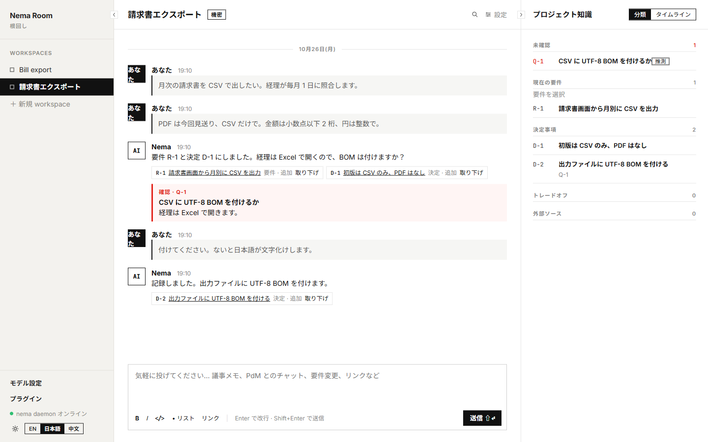
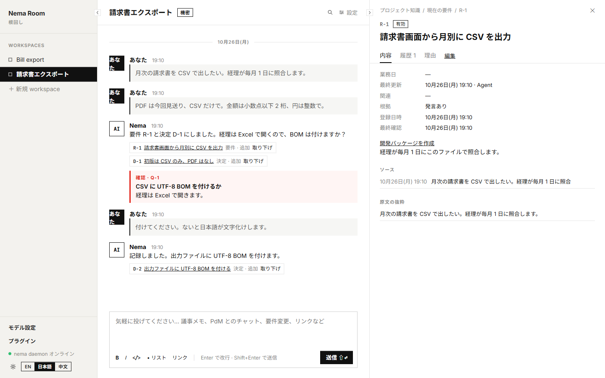

<div align="center">


<h1>Nema Room</h1>

<p><strong>議論から実装まで、プロジェクトの理解を揃える。</strong></p>

<p>
<a href="https://github.com/Nema-Project/nema-room/releases/latest"></a>
<a href="https://github.com/Nema-Project/nema-room/actions/workflows/ci.yml"></a>
<a href="LICENSE"></a>
</p>

<p>
<a href="https://github.com/Nema-Project/nema-room/releases/latest">ダウンロード</a> ·
<a href="#クイックスタート">クイックスタート</a> ·
<a href="#議論から実装まで">ワークフロー</a> ·
<a href="#ドキュメントとフィードバック">ドキュメント</a> ·
<a href="ROADMAP.md">ロードマップ</a>
</p>

<p><a href="README.zh.md">简体中文</a> · <a href="README.md">English</a> · <strong>日本語</strong></p>

</div>

Nema Room は、ソフトウェアプロジェクトの理解を揃えるための、手元で動くコパイロットです。依頼や制約、トレードオフは散らばりやすく、同じ要件でも読み方が分かれることがあります。ここで Agent と議論し、出典と Git の履歴を残し、自分の発言と Agent の推論を分け、食い違いを計画にする前に解消します。承認した spec と plan を **Codex や Claude Code** に渡し、コミット報告は議論へ戻します。



<p align="center"><sub>サンプルの議論と、確認・修正・追跡できる知識の項目。</sub></p>

<a id="主な機能"></a>

## Nema Room でできること

- **理解を揃える。** 散らばった記録を一つの記録にまとめます。新しい発言が有効な決定と食い違うときは、コパイロットがスレッドで尋ね、あなたの判断を待ちます。
- **判断の根拠を残す。** 要件、決定、トレードオフ、未解決の質問に出典を保持。ユーザーの発言と Agent の推論を区別します。
- **知識をバージョン管理。** 変更は Git に記録。項目を修正・取り下げても、履歴と出典は残ります。
- **コードを踏まえて議論。** ローカルリポジトリを登録し、メインブランチのコミット済みコードを検索。図の生成や、古くなった図の表示にも対応します。
- **意図を引き継ぐ。** 開発パッケージを生成し、不明点を解消。人が spec と plan を承認してから、コーディング Agent に渡します。
- **証拠を議論に戻す。** コミット報告を要件に結び付け、その Git の証拠を議論の中で確認します。

**なぜ Nema？** 名は根回しに由来します。決定の前に理解を揃えつつ、食い違いも根拠も見える形で残します。

日本語・英語・中国語の UI · ライト／ダークテーマ · 独立した議論スレッド

<details>
<summary>要件の根拠を見る</summary>

元の発言と記録した理由を確認し、ユーザーの発言と Agent の推論を区別できます。



</details>

## クイックスタート

<a id="デスクトップアプリプレビュー"></a>

### デスクトップアプリ

[最新リリース](https://github.com/Nema-Project/nema-room/releases/latest)からデスクトップ版を 1 つダウンロードします。Windows では 2 つのダウンロードから 1 つを選びます。

| プラットフォーム | ダウンロード |
| --- | --- |
| Windows x64 | `.exe` インストーラー、または `.zip` ポータブル版 |
| macOS · Apple シリコン | `.dmg` |
| Linux / Intel Mac | 下記の Web / Compose を使用 |

Windows の `.exe` は NSIS インストーラーです。ショートカット、アンインストール、上書き更新が使えます。`.zip` は展開してそのまま実行するアプリです。展開して `Nema.exe` を実行します。ショートカットもアンインストーラーもなく、インストーラーの繰り返しコピーを避けられます。どちらも `~/.nema/desktop` を使います。どちらか一方を選んでください。

1. [Git 2.31 以降](https://git-scm.com/downloads)をインストールしてから、Nema Room をインストールして開くか、ポータブル ZIP を展開して `Nema.exe` を実行します。Node とローカル DB は同梱されており、Docker は不要です。
2. **アプリ設定 → モデル**で ChatGPT サブスクリプション、Claude サブスクリプション、または Responses API 互換の API キーを接続します。利用可否や料金はプロバイダーによります。
3. ワークスペースを作成して議論を始めます。コードの文脈が必要になったら、ローカルリポジトリを登録します。

> **プレビュー版。** Windows のインストーラーとポータブル ZIP は未署名、macOS はアドホック署名で未公証です。リリースのチェックサムでダウンロードを確認してください。アプリは更新をダウンロードもインストールもしません。GitHub の新しい安定版を確認し、そのリリースページへリンクします。**アプリ設定 → 情報**の「更新を自動で確認する」で止められます。更新前にトレイから終了し、`~/.nema/desktop` をバックアップしてください。2026-10-27 のホストされた Windows と macOS ランナーで、使い捨てデータディレクトリの移行とバックアップ復元は通りました。同じ日、メンテナーが macOS と Windows で新しいパッケージを既存のインストールに上書きし、workspace のデータはどちらも残っていました。初回起動と制限は[デスクトップガイド](docs/guide.ja.md#desktop)を参照してください。

<a id="初回リリースの範囲と動作条件"></a>

### Web / Compose

このリポジトリを開発するときは、チェックアウトから PostgreSQL、hub、web をビルドします。tag `v0.1.4` がイメージを初めて公開するリリースです。daemon はイメージに入っていません。ホストで動かします。daemon のパッケージは `@nema-project/nema` です。`@nema-project/nema@0.1.3` は 2026-10-27 に npm へ公開され、その手動公開は [scripts/npm/RELEASE.md](scripts/npm/RELEASE.md) に記録しています。Windows、macOS、Linux 上の **Node.js ≥ 22**、**Git**、**Docker**、**Docker Compose v2** が必要です。

```sh
git clone https://github.com/Nema-Project/nema-room.git
cd nema-room
# Linux と macOS のみ。Windows の Docker Desktop では不要です。
export NEMA_UID="$(id -u)" NEMA_GID="$(id -g)"
node scripts/setup.mjs --lang ja
```

ウィザードが依存関係を確認し、CLI をビルドしてソースからサービスを起動し、モデル設定を案内します。ホストの daemon は起動したままにしてください。既存の `.env` は保持されます。`npm run up` は同じソースビルドです。Linux と macOS では、UID/GID が 1000 でもそれ以外でも、上と同じように `NEMA_UID` と `NEMA_GID` を export してから `npm run up` してください。hub がデータディレクトリへ書き込めます。Windows の Docker Desktop ではこの export は不要です。その後 [localhost:3000](http://localhost:3000) を開きます。公開用 compose ファイルにビルド手順はありません。

clone せずにピン留めしたイメージを pull できるのは tag `v0.1.4` からです。この tag はイメージ公開ワークフローを含み、これらのイメージの最初の公開です（`linux/amd64`。arm64 は [issue #50](https://github.com/Nema-Project/nema-room/issues/50)）。このリポジトリのツリーにある `docker-compose.yml` はテンプレートです。hub と web の `image:` は `${NEMA_IMAGE_TAG:-latest}` の展開で、ツリーには使えるバージョンがありません。現在のリリースワークフローで版を公開すると、hub と web のイメージをその版に固定したレンダリング済み `docker-compose.yml` も添付されます。インストール時はそのバージョンをローカルの `.env` の `NEMA_IMAGE_TAG` に固定します。この資産を持つ公開済み Release はまだないため、tag `v0.1.5` から [`docker-compose.yml`](https://github.com/Nema-Project/nema-room/blob/v0.1.5/docker-compose.yml) を取得します（`curl -fsSLO https://raw.githubusercontent.com/Nema-Project/nema-room/v0.1.5/docker-compose.yml`）。この tag 上のファイルはリリースの添付ファイルではありません。Linux と macOS では同じように `NEMA_UID` と `NEMA_GID` を export します。Windows の Docker Desktop ではこの export は不要です。そのあと `docker compose up -d` を実行します。ホストのポートは `NEMA_HUB_PORT`（既定 4400。コンテナも同じポートで待ち受けます）と `NEMA_WEB_PORT`（既定 3000。コンテナ内は 3000 のまま）に従います。`NEMA_HUB_URL` の既定値は `http://127.0.0.1:$NEMA_HUB_PORT` で、web コンテナの起動時に読まれるので、公開イメージを再ビルドせずにアドレスを変えられます。

公開版のインストールには、入れるバージョンに対応する上記リンクの Compose ファイルを使い、同じ版の daemon を入れます。版はそのファイルで両イメージが固定されているバージョンです。main は公開済みの成果物より先に進むことがあるため、開発には `npm run up` でソースからビルドします。成果物の公開は実機・機能の受け入れ確認の代わりにはなりません。

[手動インストールと設定](docs/guide.ja.md#source-installation) · 環境の確認のみ：`node scripts/setup.mjs --lang ja --check`

ホストの daemon は npm パッケージ `@nema-project/nema` です（Node.js ≥ 22）。コマンド名は `nema` です。`@nema-project/nema@0.1.3` は 2026-10-27 にメンテナーのアカウントから公開されました。`v0.1.4` は `scripts/npm/RELEASE.md` の trusted publisher による最初の公開です。実行中の hub と同じバージョンを入れます。

```sh
npx @nema-project/nema@<hub のバージョン> --version
npm i -g @nema-project/nema@<hub のバージョン>
```

上のコマンドのバージョンは、取得した `docker-compose.yml` の 2 つの `image:` が固定している版です。`grep -o 'nema-room-hub:[0-9.]*' docker-compose.yml | head -1 | cut -d: -f2` で表示され、`nema-room-web:` の側も同じ値を表示しなければなりません。ソースのチェックアウトでは daemon をこのツリーからビルドし、この方法ではバージョンを選びません。`.env` に `NEMA_IMAGE_TAG` を代わりに書き込むものはまだありません。固定名 Compose 資産とともに、固定したバージョンを記録するインストーラが入ります。それまでは取得したファイルから版を読んでください。

Compose はそのバージョンを `http://127.0.0.1:4400/api/version` で返します。デスクトップ版は **アプリ設定 → 情報** に表示し、ループバックの `GET /_nema/version` でも読めます。バージョンが違うと daemon は `run: npm i -g @nema-project/nema@<バージョン>` を出して再接続しません。`nema daemon` の `--hub` の既定値は `http://127.0.0.1:4400` で、トークンは `$NEMA_DATA_DIR` または `~/.nema/data` の `daemon-token` です。hub が起動時にそのファイルを書きます。Compose はホストのデータディレクトリを `/data` にマウントします。

このリポジトリの開発は上のソースインストールのままです。バージョンを付けない `@nema-project/nema` を入れて hub と一致するとみなさないでください。

## 議論から実装まで

実装はループです。コミット報告は議論に戻ります。

1. **議論** — アイデアやトレードオフを送り、Agent の解釈を確認。`/thread` で独立した議論を始めます。
2. **接続** — ローカルリポジトリを登録し、コミット済みのコードを議論に取り込みます。
3. **整理** — `superpowers` を有効にし、active な要件から spec と plan を含む開発パッケージを生成。不明点に回答します。
4. **承認** — 人が確認・承認した後、コーディング Agent が取得。編集や再生成で承認は取り消されます。
5. **追跡** — コミット報告と、それに紐づく Git の証拠を議論へ戻します。

```text
Discussion → Requirements + decisions → Approved spec + plan → Coding agent
                      ↑                                           │
                      └──────────── Commit reports ────────────────┘
```

ソースからのインストールでは、Nema Room のルートで一度 `npm link --workspace @nema/cli` を実行し、登録済みのコードリポジトリで次を実行します。

```sh
nema wp list
nema wp get W-1
```

[CLI の報告と hooks](docs/guide.ja.md#workflow)で実装の進捗をルームに戻せます。デスクトップ版では[同梱の CLI ランチャー](docs/guide.ja.md#desktop)を使います。

**`verified` は Git の証拠が検査を通ったか、ユーザーが確認したことを示します。** テスト合格や要件の受け入れ完了を意味しません。

<a id="データプライバシー既知の制限"></a>

## データと利用範囲

- **ローカルに保存。** デスクトップのデータは `~/.nema/desktop`。Web / Compose は PostgreSQL とローカルの知識 Git リポジトリを使用します。
- **モデルに文脈を送信。** チャット、知識、ツールが返すコードは選択したモデルプロバイダーに送られます。ローカル保存はオフライン推論ではありません。
- **GitHub は任意。** プラグインはログイン済みのローカル `gh` を使い、登録済みリポジトリだけにアクセス。書き込みには別途許可が必要です。
- **ローカル利用向け。** 公開サーバー用の複数ユーザー認証はありません。複数端末の同期、自動バックアップ、チームの閲覧専用アクセスは未対応です。

[保存先・バックアップ・既知の制限](docs/guide.ja.md#data)を参照してください。ソースリポジトリのコピーは、アプリデータのバックアップではありません。

<a id="モデルの実行方式"></a>
<a id="開発とアップグレード"></a>

## ドキュメントとフィードバック

[モデル設定](docs/guide.ja.md#models) · [開発とアップグレード](docs/guide.ja.md#development)

| ドキュメント | 内容 |
| --- | --- |
| [ユーザーガイド](docs/guide.ja.md) | インストール、モデル設定、デスクトップ操作、CLI、バックアップ、更新 |
| [技術リファレンス](docs/reference.zh-CN.md) · 中文 | コマンド、開発パッケージの書式、プラグイン、実装の詳細 |
| [Agent 開発ガイド](AGENTS.md) | ローカル・リモートのコーディング Agent 共通の開発規約 |
| [貢献ガイド](CONTRIBUTING.md) · 中文 | 開発環境、ディレクトリ構成、チェック |
| [デスクトップビルドガイド](scripts/desktop/README.md) | ネイティブビルド、同梱ツール、パッケージング |
| [ロードマップと受け入れ台帳](ROADMAP.md) · 中文 | 安定化の優先順位、TODO、受け入れの根拠 |
| [変更履歴](CHANGELOG.md) | 各リリースの変更 |
| [セキュリティポリシー](SECURITY.md) · 中文 | 報告方法とセキュリティの範囲 |

不具合やアイデアは [issue](https://github.com/Nema-Project/nema-room/issues/new/choose) へ。OS、インストール方法、機密情報を除いたエラーを記載してください。日本語・英語・中国語での貢献を歓迎します。

セキュリティ上の問題は [非公開の脆弱性報告](https://github.com/Nema-Project/nema-room/security/advisories/new) から送り、[セキュリティポリシー](SECURITY.md) を確認してください。公開 issue や PR に機密情報を書かないでください。管理者ではない read 権限のアカウントが 2026-10-27 にフォームへ到達し、テスト報告は同日、未公開のまま閉じられました。修正は main に入り、以降のデスクトップ版で配布されます。旧リリース系列の個別保守は約束していません。

---

[MIT](LICENSE) © Nema-Project contributors。第三者のライセンスと出典：[archify](vendor/archify/VENDORED.md) · [superpowers rules](vendor/superpowers-rules/VENDORED.md)。
