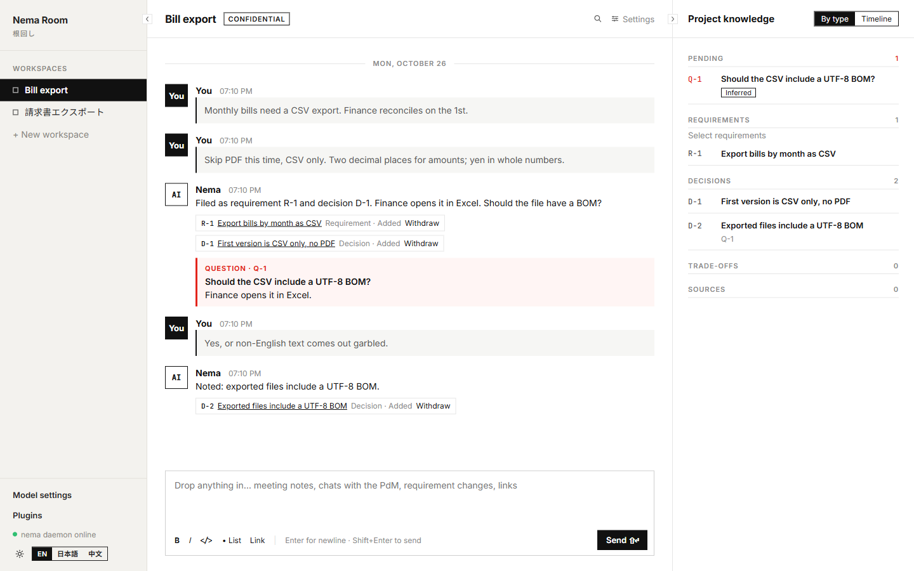
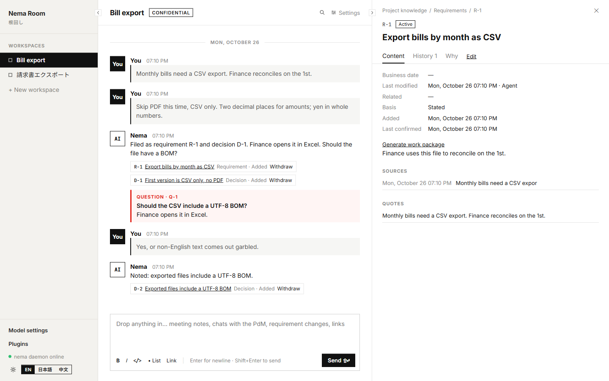

# Nema Room

[Roadmap and acceptance tracker (Chinese)](ROADMAP.md)


**Turn scattered discussions into traceable requirements, then hand them to a coding agent.**

[简体中文](README.zh.md) · English · [日本語](README.ja.md)

> **0.1.1:** Desktop installers are published for Windows x64 and Apple Silicon. The app runs on your machine and uses Git 2.31 or later already installed there. Multi-device sync, backup, and team read-only access come later. "Quick start" below is still the Web / Compose version. See [Desktop app](#desktop-app-preview).

Nema Room is a requirements discussion room that runs locally. Share ideas, meeting notes, and tradeoffs in chat; an agent organizes them into requirements, decisions, questions, and sources. Knowledge changes have Git history. When you are ready to build, generate a spec and plan, then track progress through your coding agent's commit reports.

The interface below is the app, using a sample discussion. Chat stays in the middle. Filed entries stay on the right, and an open question stays marked.



Opening an entry shows why it was filed and the sentence it came from.



## Features

- **Discussion to knowledge**: manage requirements, decisions, tradeoffs, questions, sources, code diagrams, and work packages.
- **Traceable evidence**: distinguish user statements, user decisions, and agent inferences; inspect quotes, history, and reasons for changes.
- **Code context**: bind local repositories, read main-branch snapshots, search code, and generate diagrams with staleness indicators.
- **Development handoff**: clarify questions, generate a work package, and approve it for Codex or Claude Code.
- **Implementation tracking**: check commits, main-branch inclusion, and file changes, with manual confirmation available.
- **Threads and longer discussions**: the agent can move a long discussion into a thread; type `/thread` to start one manually and continue in a separate window. Unread badges in the sidebar take you to the next thread that needs attention.
- **Knowledge controls**: retract incorrectly recorded knowledge while keeping its history and sources.
- **Three UI languages**: English, Chinese, and Japanese, plus knowledge-language settings, extension management, workspace archiving, and a night-mode switch at the bottom of the sidebar.

## First release scope and requirements

Install **from source**. The CLI package is private; do not treat `npx nema` as a standalone npm installation command. Windows, macOS, and Linux share a Node.js setup wizard.

| Item | Requirement |
| --- | --- |
| Local tools | Node.js ≥ 22 with npm, Git |
| Containers | Docker and Docker Compose v2 |
| Model access | Configure a runtime below; availability, quotas, and charges depend on the provider |
| Storage | Prefer a local SSD; avoid NAS/SMB shares for the project, knowledge Git repositories, and database |
| Platform | Windows, macOS, Linux; use Docker Desktop with Linux containers on Windows/macOS, or Docker Engine on Linux |

This is a local application without public-facing multi-user authentication. The hub and web UI default to loopback access; do not expose them directly to the internet.

## Quick start

Run in PowerShell, Terminal, or a Linux terminal:

```text
git clone https://github.com/Nema-Project/nema-room.git
cd nema-room
node scripts/setup.mjs --lang en
```

The wizard checks Node/npm, Git, Docker, and Compose, preserves an existing `.env`, installs dependencies, builds the CLI, and starts services. It then guides model selection and connection checks, with an option to start the daemon in the terminal. You can rerun it; it does not install system software, delete application data, or overwrite existing configuration files. Selecting a model mode updates the corresponding local model settings.

Read-only check: `node scripts/setup.mjs --lang en --check`. With npm available, `npm run setup -- --lang en` also works. `--check` checks that Docker is running and does not send model requests.

### Manual installation (Bash)

Compose runs PostgreSQL, the hub, and web. **The daemon runs on your host**, using local credentials and repository paths.

```bash
git clone https://github.com/Nema-Project/nema-room.git
cd nema-room
cp .env.example .env
npm ci
npm run build -w apps/cli
mkdir -p "$HOME/.nema/data"
docker compose up -d --build
```

Configure model access first. For the default authentication mode:

```bash
node apps/cli/dist/index.js auth login
node apps/cli/dist/index.js auth probe
node apps/cli/dist/index.js doctor
node apps/cli/dist/index.js daemon
```

Open [localhost:3000](http://localhost:3000), create a workspace, and send a discussion. Keep the daemon running; new tasks queue while it is offline. `auth probe` sends a minimal model request and consumes the selected service's quota.

```bash
npm run logs   # Hub / web logs
npm run down   # Stop containers; retain the database volume
```

On Linux, set `NEMA_UID` / `NEMA_GID` in `.env` if your UID/GID is not 1000. Create custom data directories yourself and ensure `NEMA_DATA_HOST_DIR` matches the directory read by the daemon.

## Desktop app (preview)

The desktop app puts the whole stack in one local program: an on-disk PGlite database, a single-owner local core, a protected same-origin gateway, and bundled Node. It uses the Git already on your machine (2.31 or later). On macOS, an app opened from the Finder also finds Homebrew and MacPorts Git. If Git is missing or older, the app says so on launch and links to https://git-scm.com/downloads. It needs neither Docker nor a database server. **Desktop 0.1.1 is published** for Windows x64 and Apple Silicon: [download the installers](https://github.com/Nema-Project/nema-room/releases/tag/v0.1.1).

| Item | Status |
| --- | --- |
| Windows x64 | 0.1.1 NSIS installer published |
| macOS | 0.1.1 DMG for Apple Silicon (arm64). Intel Macs are not a target |
| Linux | No desktop installer |
| Signing and updates | Installers are **unsigned**; there is no auto-update |
| Public release | [0.1.1](https://github.com/Nema-Project/nema-room/releases/tag/v0.1.1). Node (MIT), Inter and JetBrains Mono (OFL), and Electron's ffmpeg (LGPL, its own library) ship with their notices |

**Build (Windows x64):** after `npm ci`, run `npm run desktop:make -- --platform win32 --arch x64`. Output goes to `dist/desktop-artifacts/win32-x64/`: `Nema-<version>-win32-x64.exe` (NSIS installer). A build only targets the current OS and needs a native C compiler (Clang on Windows; see [scripts/desktop/README.md](scripts/desktop/README.md)).

**Opening an unsigned installer for the first time:** open only a file you built or checked yourself. Windows SmartScreen shows "Windows protected your PC": choose "More info", then "Run anyway". The macOS package is unverified; as usual for an app that is not notarized, it would need "Open Anyway" in System Settings → Privacy & Security.

**Where data lives:** `~/.nema/desktop` by default (`db/` database, `data/` knowledge Git repositories, `instance.json` run state). It does not read the Compose database and never uses the old `~/.nema/data`.

**Window, tray, and browser mode**
- Closing the window closes only the window; the core keeps running in the tray, and the tray icon reopens it. `Quit Nema` in the tray menu quits and waits for background work to be cleaned up.
- You can also use the same core from a browser: `resources\payload` in the install directory contains `Nema Browser.cmd` (`Nema Browser.command` on macOS, `nema-browser` on Linux). It starts or reuses the core and opens a one-time link in your browser. `--no-open` prints the link instead; `--quit` asks the core to quit. It also lets you keep working after the window process exits unexpectedly.

**Models and GitHub**
- Choose the model under "Model settings" in the app; no terminal is needed. There is one provider list: ChatGPT subscription, Claude subscription, or API key. A ChatGPT subscription uses browser login or an existing local Codex login. A Claude subscription takes a local Claude Code token. An API key takes the key and an optional Responses API address. After that provider is connected, pick a model from the list it returns. While that list is loading, the menu says so and stays closed. There is no field for a custom model ID. Claude uses the official aliases; leaving it unset keeps the account default. Each provider keeps its own login. Reasoning effort is on the same page. There is no separate Agent-runtime control.
- The GitHub plugin is off by default. After you turn it on under "Code & plugins" in the workspace, the Agent uses the `gh` you are already signed in to (run `gh auth login` once in a terminal). Nema neither asks for nor stores a GitHub token. Reading comes with the plugin. Changing GitHub (creating and commenting on issues, editing labels, updating Projects) needs the allow switch on that same page. The Agent can only reach the github.com repositories bound to that workspace.

**Coding-agent report hooks:** the hooks that `nema report install` writes (the packaged app does not put `nema` on PATH: from the install directory's `resources\payload` folder run `Nema CLI.cmd report install --agent claude`, or `Nema CLI.command` on macOS and `nema-cli` on Linux; the hooks then point at the bundled Node and CLI by absolute path) use the per-user `~/.nema/report-token`, which the desktop app registers with its local core at startup. While the app runs, a hook finds it and verifies its identity automatically. **After installing hooks, restart the desktop app** so the token is registered. While the app is not running, reports go to a local spool (at most 5 MB, kept 7 days) and are sent with the next report.

**Migrating from the Web / Compose version:** there is only a library interface so far, with no command or UI. `exportSnapshot` (`apps/hub/src/db/export.ts`) exports from a PostgreSQL connection you name, and `importLegacySnapshot` (`apps/local/src/import.ts`) imports into an **empty, stopped** desktop data directory. The import validates everything in a staging directory first and leaves the destination untouched on failure; use `recoverInterruptedImport` after an interruption. Credentials are neither exported nor imported, so sign in again.

**Upgrading:** the desktop app has no auto-update. Quit with `Quit Nema` in the tray, back up `~/.nema/desktop`, then install the new version; database migrations run on startup. **Upgrading in place over an older installer has not been verified**, so back up first.

**Known limitations:** cleanup of background helper processes is guaranteed only on Windows so far (POSIX is unproven), and the full Windows test run has 0 failures locally but 23 tests are skipped by gates (not Windows acceptance), and POSIX and CI have not been re-run. See the [validation record](docs/reviews/2026-10-24-desktop-validation.md).

## Model runtimes

The default adapter, `codex-direct`, runs Nema's own tool loop without launching the Codex CLI. The model receives Room functions and the plugins enabled for that task. The four rows below are what the three providers in the app save; the app does not show these internal names.

| Mode | Setup and limitations |
| --- | --- |
| Sign in with ChatGPT (default `siwc`) | Run `auth login`, then `auth probe` to verify access; not guaranteed for every subscription or organization account |
| BYOK API key | Requires a Responses API-compatible endpoint and an explicit model; billed under the provider's terms |
| Codex login compatibility | `config set authMode compat`; reads `$CODEX_HOME/auth.json`, default `~/.codex/auth.json`, without refreshing or modifying it. Uses a non-public backend that may stop working or violate service terms |
| Claude Code | `config set adapter claude-code`; requires local `claude`, `claude setup-token`, and `auth claude` |

To switch to BYOK:

```bash
node apps/cli/dist/index.js config set authMode byok
node apps/cli/dist/index.js config set model YOUR_MODEL
# Optional, for another compatible provider:
# node apps/cli/dist/index.js config set byokBaseUrl https://your-provider.example/v1
node apps/cli/dist/index.js auth byok
```

`auth byok` reads one key from standard input: paste it and press Enter. Use a private terminal; input may be echoed. `auth claude` and `auth github` also read standard input. Keep real credentials out of command arguments, repositories, and issues.

Configure Claude Code:

```bash
node apps/cli/dist/index.js config set adapter claude-code
claude setup-token
node apps/cli/dist/index.js auth claude
```

Nema does not silently switch runtimes after authentication or model failures. `config get` and `auth status` show configuration and login status without printing tokens.

## From discussion to delivery

1. **Discuss**: send notes, then review, confirm, or correct the agent's interpretation in the knowledge panel. You can quote any message, edit your own (the previous text is kept and the agent re-runs), and search the workspace by keyword from the icon in the header. Type `/` for a command menu. Diagram types are listed, such as `/diagram:sequence`, and the list narrows as you type. Progress and updating an existing diagram are there too.
1. **Thread discussions**: use `/thread` to start a new long discussion, or let the agent move the current conversation into a thread when it needs back-and-forth. Threads open in a separate window, and unread badges in the sidebar take you to the next one that needs attention. The agent acts like a copilot: memo checks and casual chat do not write knowledge; the main chat and threads follow the same recording rules. When there is no clear decision, it asks first. Unless you clearly overturn an existing decision, it keeps that decision and asks in the current thread. When you clearly overturn one, the old decision is marked as superseded and the new one is recorded.
2. **Connect code**: bind a local Git repository from settings with the system folder picker. After a folder is chosen, the remote and the detected main branch are shown, and the name is the folder name. A name is typed only when that name is already used. The dialog opens in the host daemon. Windows uses the Explorer-style picker. Graphify is read from `tools/graphify/` in the install payload. It is not installed from `PATH` and is not downloaded at runtime. `desktop:stage` places pinned CPython 3.11.17 and graphifyy 0.9.95 there, and the launcher uses only a path relative to itself. When it is missing, indexing and code search report `随包的 Graphify 运行环境缺失`, and the plugins page shows the same sentence. There is no repair button. Binding a repository indexes it once. A full extract may take a few minutes. Chat shows progress while the index runs, then says the index is ready and code questions can start. The architecture diagram is drawn after that index finishes, with its own progress line. After that the daemon does not `git fetch` on a clock: the first time a task reads that repository, it fetches the main branch and reads the committed snapshot, excluding uncommitted changes. Later reads in the same task reuse that result.
3. **Generate a work package**: select active requirements and enable `superpowers` to generate a spec and plan. The `grill-me` plugin can create a blocking question when information is missing. Answer it under that question in the chat. An older open question can be answered on its own card, and generation retries.
4. **Approve and hand off**: review and approve manually, then let your coding agent retrieve it. Editing or regenerating revokes approval.
5. **Report and verify**: track `reported`, `verified`, and `mismatch`. **Verified means Git evidence passed or the user confirmed it, not that tests passed, the feature is correct, or acceptance criteria were met.**

Work packages currently require fixed Chinese format markers even when the knowledge language is English or Japanese, including `## 已定的做法`, `### 任务 1：`, `- 修改：`, and `- 满足：`. See the detailed reference for the full constraints.

To use `nema` from another repository, first link the CLI from this project's root. You may need to add npm's global bin directory to PATH:

```bash
npm link --workspace @nema/cli
```

Then, inside a bound code repository:

```bash
nema wp list
nema wp get W-1
nema report --entries W-1 --task 1 --summary "Implement task 1" --commits COMMIT_SHA --files src/example.ts
```

Optional reporting hooks: `nema report install --agent codex` or `--agent claude`. This modifies the agent's user-level hook configuration and installs the `nema-report` skill. Remove it with `nema report uninstall --agent <agent>`.

The GitHub plugin is off by default. How to turn it on, sign in with `gh`, and allow writes is in the desktop section above; the Web / Compose daemon uses the same path. The command allowlist and the six older read functions are in the technical reference. `nema auth github` can still write a token to `~/.nema/github-token`; the default path does not read it.

## Data, privacy, and known limitations

| Default location | Contents |
| --- | --- |
| PostgreSQL Compose volume `nema-pg` | Chat, tasks, workspace settings, indexes, and related records |
| `~/.nema/data` | Daemon token and workspace knowledge Git repositories |
| `~/.nema` | Local configuration, model/plugin credentials, code index snapshots, report spool, and related files |
| `~/.nema/desktop` | The desktop app's database, knowledge Git repositories, and run state; independent of the Compose data above |

**A GitHub copy of this source repository is not an application-data backup.** Stop writes before backing up, retain a PostgreSQL export and the actual data directories, and validate recovery. To preserve data, do not use `docker compose down -v`: `-v` deletes the database volume.

- Local storage is not offline inference: chat, knowledge, and code returned by tools go to the model provider. When the GitHub plugin is on, queries go to GitHub through your local `gh`; writing needs a separate opt-in in the workspace. A confidential workspace is not an offline mode or operating-system isolation boundary.
- Ordinary task limits: 24 model calls, 60 tool calls, 10 minutes. Work packages: 48, 120, 20 minutes. Interrupted tasks retry up to three times.
- Startup can recover some uncommitted knowledge files, but Git and database indexes do not have complete automatic reconciliation.
- SIWC refresh failures may require another login. The implementation checks ID token claims but does not verify JWKS signatures.
- Credentials use `0600` on macOS/Linux and private ACLs on Windows, limited to the current user, SYSTEM, and administrators. Reads reject broad permissions and symbolic links.
- Claude Code runs as the local user; tool restrictions are not a separate operating-system sandbox.

## Development and upgrades

Development mode runs only PostgreSQL in Docker:

```bash
npm ci
cp .env.example .env  # Do not overwrite existing configuration
npm run build -w apps/hub
npm run build -w apps/cli
npm run db:up
npm run dev
```

Start `node apps/cli/dist/index.js daemon` in another terminal. Do not also run the Compose hub/web: their ports overlap.

```bash
npm test
npm run typecheck
npm run typecheck -w apps/cli
npm run lint -w apps/web
npm run build -w apps/web
```

The root typecheck excludes web; build it separately. Before upgrading, back up data, then run `git pull`, `npm ci`, rebuild the CLI and Compose images, and restart the daemon. Keep hub and CLI versions aligned.

See [.env.example](.env.example) for ports and directories. The CLI does not automatically load the root `.env`: export `NEMA_DATA_DIR` or pass `--token-file` to `daemon` / `doctor` for a custom data directory; also pass `--hub` for a different hub port. Changing `NEXT_PUBLIC_HUB_URL` requires rebuilding web.

## Documentation and feedback

- [Detailed command and implementation reference (Chinese)](docs/reference.zh-CN.md)
- [Changelog](CHANGELOG.md)
- [Designs and implementation plans](docs/superpowers/)
- [Contributing (Chinese)](CONTRIBUTING.md)
- [Security policy (Chinese)](SECURITY.md): the repository is private, so use the security issue template named there. Do not paste credentials.
- [Report an issue](https://github.com/Nema-Project/nema-room/issues/new/choose): use a template. Include your OS, Node/Docker versions, how you run Nema Room, and redacted errors.

This project is licensed under the [MIT License](LICENSE). Third-party components include archify and writing rules adapted from superpowers. License and source records are retained in [archify](vendor/archify/VENDORED.md) and [superpowers-rules](vendor/superpowers-rules/VENDORED.md); retain their licenses and copyright notices as well.
