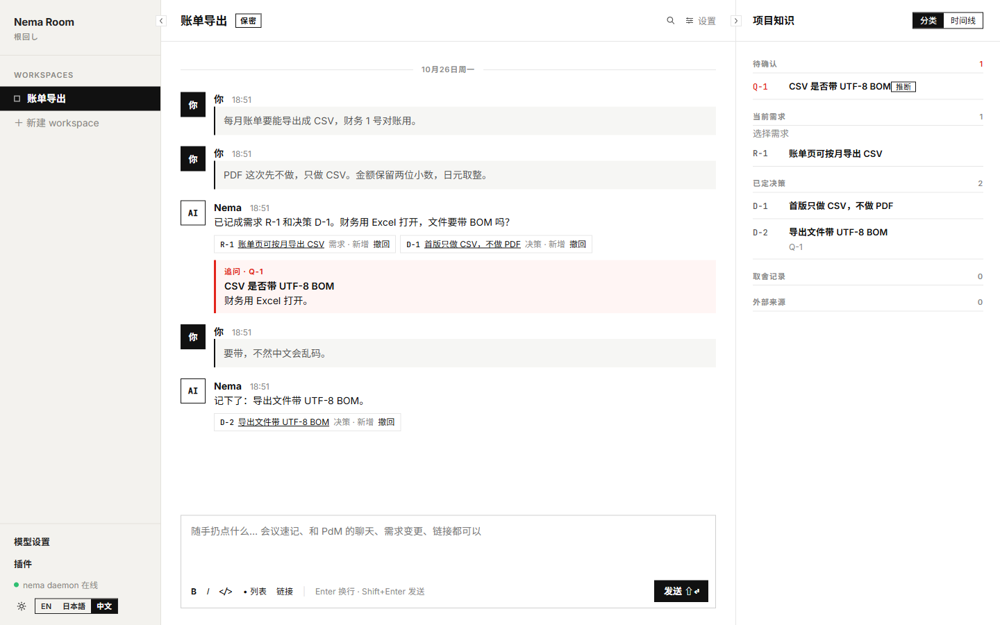
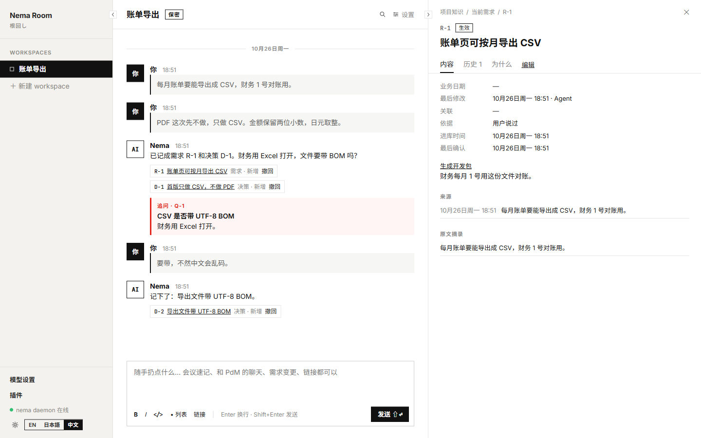

<div align="center">


<h1>Nema Room</h1>

<p><strong>让项目保持对齐，从讨论直到交付。</strong></p>

<p>
<a href="https://github.com/Nema-Project/nema-room/releases/latest"></a>
<a href="https://github.com/Nema-Project/nema-room/actions/workflows/ci.yml"></a>
<a href="LICENSE"></a>
</p>

<p>
<a href="https://github.com/Nema-Project/nema-room/releases/latest">下载</a> ·
<a href="#快速开始">快速开始</a> ·
<a href="#从讨论到交付">工作流</a> ·
<a href="#文档与反馈">文档</a> ·
<a href="ROADMAP.md">路线图</a>
</p>

<p><strong>简体中文</strong> · <a href="README.md">English</a> · <a href="README.ja.md">日本語</a></p>

</div>

Nema Room 是在本机运行的项目对齐副驾。需求、约束和取舍很容易散落，同一条需求也可能被读成不同的意思。在这里和 Agent 一起讨论：保留来源和 Git 历史，分清你的原话和 Agent 的推断，冲突在写进计划之前先澄清。批准 spec 和 plan 后交给 **Codex 或 Claude Code**，提交上报再回到讨论里。



<p align="center"><sub>一段示例讨论，以及可以检查、修正、追溯的知识条目。</sub></p>

<a id="功能"></a>

## 为什么用 Nema Room

- **把理解对齐。** 把散落的记录收成同一份。新的说法和已有决策冲突时，副驾会在线程里提问，并等你来定。
- **保留决策依据。** 需求、决策、取舍和待确认问题都有来源，用户陈述与 Agent 推断明确区分。
- **让知识有版本。** 修改记录在 Git 中；修正或撤回条目时，历史与来源仍然保留。
- **带着代码讨论。** 绑定本机仓库，搜索主分支的已提交快照，生成代码图并提示可能过时的内容。
- **明确交接内容。** 生成开发包、澄清阻塞问题，人工批准 spec 和 plan 后再交给编码 Agent。
- **把证据带回讨论。** 把提交上报关联到需求，在讨论里查看这些 Git 证据。

**为什么叫 Nema？** 这个名字来自日语「根回し」（nemawashi），指在决定之前先把理解和顾虑理清。Nema Room 把这种协调留在明处：不同意见保持可见，决定则带着证据。

中文、英文、日文界面 · 明暗主题 · 独立讨论线程

<details>
<summary>展开查看：一条需求的依据</summary>

每条需求都能回到原话，查看记录原因，区分用户陈述与 Agent 推断。



</details>

## 快速开始

<a id="桌面应用预览"></a>

### 桌面应用

从[最新发布页](https://github.com/Nema-Project/nema-room/releases/latest)下载一个桌面版本。Windows 上两个下载里选一个。

| 平台 | 下载 |
| --- | --- |
| Windows x64 | `.exe` 安装包，或 `.zip` 便携应用 |
| macOS · Apple 芯片 | `.dmg` |
| Linux / Intel Mac | 使用下方 Web / Compose 方式 |

Windows 的 `.exe` 是 NSIS 安装包：会建立快捷方式，可以卸载，也可以覆盖升级。`.zip` 是解压即可运行的程序目录：解压后运行 `Nema.exe`，没有快捷方式，也没有卸载程序，并且避开安装器里的重复拷贝。两者都使用 `~/.nema/desktop`。选其中一个。

1. 安装 [Git 2.31 或更新版本](https://git-scm.com/downloads)，然后安装并打开 Nema Room，或解压便携 ZIP 后运行 `Nema.exe`。Node 和本地数据库已随包提供，无需 Docker。
2. 在**应用设置 → 模型**中连接 ChatGPT 订阅、Claude 订阅或兼容 Responses API 的 API 密钥。可用性与费用由服务商决定。
3. 创建工作区，开始讨论；需要代码上下文时，再绑定本机仓库。

> **预览版本。** Windows 安装包和便携 ZIP 都未签名，macOS 使用临时签名且未经公证。请按发布页的校验和核对下载。应用不会自动下载或安装。它会向 GitHub 查询更新的稳定版并链到发布页；可在**应用设置 → 关于**里关掉「自动检查更新」。升级前从托盘退出并备份 `~/.nema/desktop`。2026-10-27 的托管 Windows 与 macOS 运行器已通过一次性数据目录迁移和备份恢复。同日维护者在 macOS 与 Windows 上分别用新安装包覆盖旧安装，workspace 数据均完整。首次启动与已知限制见[桌面使用指南](docs/guide.zh.md#desktop)。

<a id="首版范围与环境要求"></a>

### Web / Compose

开发本仓库时，从检出构建 PostgreSQL、hub 和 web。tag `v0.1.4` 是第一次发布镜像的版本。daemon 不在镜像里，仍在本机运行。daemon 的包是 `@nema-project/nema`。`@nema-project/nema@0.1.3` 已于 2026-10-27 发布到 npm，这次手动发布记录在 [scripts/npm/RELEASE.md](scripts/npm/RELEASE.md)。需要 **Node.js ≥ 22**、**Git**、**Docker** 和 **Docker Compose v2**，系统可以是 Windows、macOS 或 Linux。

```sh
git clone https://github.com/Nema-Project/nema-room.git
cd nema-room
# 仅 Linux 和 macOS。Windows 上的 Docker Desktop 不需要这一行。
export NEMA_UID="$(id -u)" NEMA_GID="$(id -g)"
node scripts/setup.mjs --lang zh
```

向导检查依赖、构建 CLI、从源码启动服务，并引导配置模型。保持本机 daemon 运行。已有 `.env` 会保留。`npm run up` 是同一条源码构建。在 Linux 和 macOS 上，无论 UID/GID 是不是 1000，都先按上面导出 `NEMA_UID` 和 `NEMA_GID`，再执行 `npm run up`，hub 才能写入数据目录。Windows 上的 Docker Desktop 不需要这条 export。然后打开 [localhost:3000](http://localhost:3000)。发布用的 compose 文件没有构建步骤。

不克隆、直接拉取钉死镜像，从 tag `v0.1.4` 开始。这个 tag 包含镜像发布工作流，也是这些镜像的第一次发布（`linux/amd64`；arm64 见 [issue #50](https://github.com/Nema-Project/nema-room/issues/50)）。本仓库树里的 `docker-compose.yml` 是模板：hub 与 web 的 `image:` 用的是 `${NEMA_IMAGE_TAG:-latest}` 插值，树里没有可用的版本。从 `v0.1.6` 起，每个 Release 都附上一份渲染好的 `docker-compose.yml`，hub 与 web 镜像都钉在该 Release 的版本上。它是该 Release 的固定名资产，所以当前版本始终在 [`releases/latest/download/docker-compose.yml`](https://github.com/Nema-Project/nema-room/releases/latest/download/docker-compose.yml)；安装时把它的版本锁进本地 `.env` 的 `NEMA_IMAGE_TAG`。不克隆的安装步骤：

```sh
# 1. fetch the fixed-name compose asset for the current supported release
curl -fsSL -o docker-compose.yml \
  https://github.com/Nema-Project/nema-room/releases/latest/download/docker-compose.yml
#    If .env already has NEMA_IMAGE_TAG, keep it and fetch that version's asset
#    instead of the latest one:
#    curl -fsSL -o docker-compose.yml \
#      https://github.com/Nema-Project/nema-room/releases/download/v<locked>/docker-compose.yml
#    A lock older than v0.1.6 has no release asset; take that tag's file instead:
#    curl -fsSL -o docker-compose.yml \
#      https://raw.githubusercontent.com/Nema-Project/nema-room/v<locked>/docker-compose.yml

# 2. read the one version both images are pinned to; hub and web must agree
grep -o 'nema-room-hub:[0-9.]*' docker-compose.yml | head -1 | cut -d: -f2
grep -o 'nema-room-web:[0-9.]*' docker-compose.yml | head -1 | cut -d: -f2

# 3. lock it in a local .env, using the version both greps printed
#    NEMA_IMAGE_TAG=<that version>
#    An existing NEMA_IMAGE_TAG stays as it is and must equal that version.

# 4. start the stack
export NEMA_UID="$(id -u)" NEMA_GID="$(id -g)"   # Linux and macOS only
docker compose up -d

# 5. install the host daemon at the version step 2 printed
npm i -g @nema-project/nema@<that version>

# 6. start the host daemon and keep it running; Compose does not run it.
#    It connects to http://127.0.0.1:4400 with the daemon-token the hub
#    wrote under ~/.nema/data.
nema daemon
```

第 2 步的两行必须打印同一个版本；不同就停下，什么都不要启动。`.env` 已经有 `NEMA_IMAGE_TAG` 时沿用旧值：第 1 步改从 `releases/download/v<locked>/docker-compose.yml` 取该版本的资产，不取 latest，这样第 2 步和第 5 步读到的都是锁定的版本；第 3 步不要覆盖它。latest 会随每次发布变化，带版本的地址在该 Release 存在期间不变。`v0.1.6` 之前的锁定版本（`0.1.4`、`0.1.5`）没有发布资产，带版本的地址会返回 404，这时改取该 tag 自己的文件 `raw.githubusercontent.com/Nema-Project/nema-room/v<locked>/docker-compose.yml`，它把双镜像钉在那个版本上。v0.1.6 的资产开头仍是仓库模板的注释，说它是模板、不是可安装的版本；这条注释已经过时，以两行钉住版本的 `image:` 为准，v0.1.6 之后的 Release 开头会写明自己的版本。第 5 步的版本就是第 2 步读出的那个版本，不是 npm 上的最新版本。agent 任务需要第 6 步的 daemon 一直在跑。Release 刚发布时，镜像或 npm 包可能还在发布中；`docker compose up` 拉不到镜像或 `npm i` 找不到该版本时，请稍等再试，或在源码检出里先跑 `node scripts/install/public.mjs --check`，它在安装前校验 Compose 资产、两个镜像和 npm 包都在。`-L` 不能省，发布页下载地址会跳转。Windows 上的 Docker Desktop 不需要第 4 步的 export。

宿主机端口跟随 `NEMA_HUB_PORT`（默认 4400，容器监听同一端口）和 `NEMA_WEB_PORT`（默认 3000，容器内仍监听 3000）。`NEMA_HUB_URL` 默认是 `http://127.0.0.1:$NEMA_HUB_PORT`，web 容器启动时读取，因此同一份已发布镜像不用重建就能换地址。

公开安装请使用你所装 Release 的 Compose 资产，并安装同版 daemon，版本就是该文件里两个镜像钉住的版本。main 可能领先于已发布产物；开发请用 `npm run up` 从源码构建。产物发布不代替真机或功能验收。

[手动安装与配置](docs/guide.zh.md#source-installation) · 只检查环境：`node scripts/setup.mjs --lang zh --check`

宿主机 daemon 是 npm 包 `@nema-project/nema`（Node.js ≥ 22），命令名是 `nema`。`@nema-project/nema@0.1.3` 已于 2026-10-27 由维护者账号发布。`v0.1.4` 是 `scripts/npm/RELEASE.md` 里受信发布者的第一次发布。安装与正在运行的 hub 相同的版本：

```sh
npx @nema-project/nema@<hub 版本> --version
npm i -g @nema-project/nema@<hub 版本>
```

上面命令里的版本，就是所取 `docker-compose.yml` 里两个 `image:` 钉的那个版本：`grep -o 'nema-room-hub:[0-9.]*' docker-compose.yml | head -1 | cut -d: -f2` 打印它，`nema-room-web:` 那条必须打印同一个值。源码检出从这棵树构建 daemon，不这样选版本。源码检出里也带 `scripts/install/public.mjs`：它解析一个已发布的版本，校验该版本的 Compose 资产、两个镜像和 npm 包都在，然后把 `NEMA_IMAGE_TAG` 和配套的 `docker-compose.yml` 一起写进目标目录；先加 `--check` 跑一遍只校验不写盘。它读的是该 Release 自己的 `docker-compose.yml` 资产，资产缺席就拒绝安装；`v0.1.6` 之前的 Release 都没有这份资产。

Compose 在 `http://127.0.0.1:4400/api/version` 返回该版本。桌面版在**应用设置 → 关于**里显示版本，其回环地址也提供 `GET /_nema/version`。版本不一致时 daemon 会打印 `run: npm i -g @nema-project/nema@<版本>` 并且不再重连。`nema daemon` 的 `--hub` 默认是 `http://127.0.0.1:4400`，token 文件是 `$NEMA_DATA_DIR` 或 `~/.nema/data` 下的 `daemon-token`。hub 启动时写入该文件。Compose 把宿主机数据目录挂到容器的 `/data`。

开发本仓库仍使用上面的源码安装。不要安装不带版本的 `@nema-project/nema` 并假定它与 hub 一致。

## 从讨论到交付

交付是一条回路：提交上报会回到讨论里。

1. **讨论** — 发送想法和取舍，检查 Agent 的理解；用 `/thread` 开启独立讨论。
2. **连接** — 绑定本机仓库，把已提交的代码带入讨论。
3. **整理** — 开启 `superpowers`，选择 active 需求，生成包含 spec 和 plan 的开发包，回答阻塞问题。
4. **批准** — 人工审阅后交给编码 Agent 获取；编辑或重新生成会撤销批准。
5. **跟踪** — 把提交上报和对应的 Git 证据带回讨论。

```text
讨论 → 需求与决策 → 已批准的 spec + plan → 编码 Agent
          ↑                                  │
          └────────── 提交上报 ──────────────┘
```

源码安装后，先在 Nema Room 根目录执行一次 `npm link --workspace @nema/cli`，再进入已绑定的代码仓库：

```sh
nema wp list
nema wp get W-1
```

通过 [CLI 上报与 hooks](docs/guide.zh.md#workflow)，把实现进度带回讨论室。桌面安装使用[随包的 CLI 启动器](docs/guide.zh.md#desktop)。

**`verified` 表示 Git 证据通过或用户确认。** 它不代表测试通过或需求验收完成。

<a id="数据隐私与已知限制"></a>

## 数据与边界

- **本机存储。** 桌面数据位于 `~/.nema/desktop`；Web / Compose 使用 PostgreSQL 和本机知识 Git 仓库。
- **模型会收到上下文。** 聊天、知识和工具读取的代码会发送给所选模型服务商。本机存储不等于离线推理。
- **按需连接 GitHub。** 插件使用本机已登录的 `gh`，仅访问绑定仓库；写入需在工作区单独开启。
- **从插件页安装 Skill。** 贴入 GitHub 仓库或 skills.sh 链接，先看固定的提交、许可证和安装目录，再选一个 Skill 安装；进度、取消和重试都在原处显示。也可以在聊天里让 Agent 安装：它会在回复下方放一张同样内容的预览卡片，你在卡片上点「安装」之前不会装任何东西。
- **面向本机使用。** 没有面向公网的多用户认证，暂不提供多设备同步、自动备份或团队只读访问。

详见[存储、备份与已知限制](docs/guide.zh.md#data)。源码仓库的副本不是应用数据备份。

<a id="模型运行方式"></a>
<a id="开发与升级"></a>

## 文档与反馈

[模型配置](docs/guide.zh.md#models) · [开发与升级](docs/guide.zh.md#development)

| 文档 | 内容 |
| --- | --- |
| [使用指南](docs/guide.zh.md) | 安装、模型配置、桌面操作、CLI、备份与升级 |
| [技术参考](docs/reference.zh-CN.md) | 命令、开发包格式、插件与实现细节 |
| [Agent 开发规范](AGENTS.md) | 本地与远程编码 Agent 共用的协作、实现和验证约定 |
| [参与贡献](CONTRIBUTING.md) | 开发环境、目录结构与检查命令 |
| [桌面构建指南](scripts/desktop/README.md) | 本机构建、随包工具与打包 |
| [项目路线图与验收台账](ROADMAP.md) | 稳定化优先级、TODO 与验收证据 |
| [变更记录](CHANGELOG.md) | 各版本的改动 |
| [安全策略](SECURITY.md) | 报告说明与安全边界 |

发现问题或有新想法？[提交 issue](https://github.com/Nema-Project/nema-room/issues/new/choose)，附上操作系统、安装方式和脱敏后的错误信息。欢迎使用中文、英文或日文参与贡献。

安全问题请通过 [GitHub 私密漏洞报告](https://github.com/Nema-Project/nema-room/security/advisories/new) 提交，并先读 [安全策略](SECURITY.md)。不要在公开 issue 或 PR 提交敏感详情。read 权限的非管理员已于 2026-10-27 到达该表单；测试报告于同日关闭且未发布。修复进入 main 并在后续桌面版本分发，不承诺维护旧发布系列。

---

[MIT](LICENSE) © Nema-Project contributors。第三方许可与来源：[archify](vendor/archify/VENDORED.md) · [superpowers rules](vendor/superpowers-rules/VENDORED.md)。
