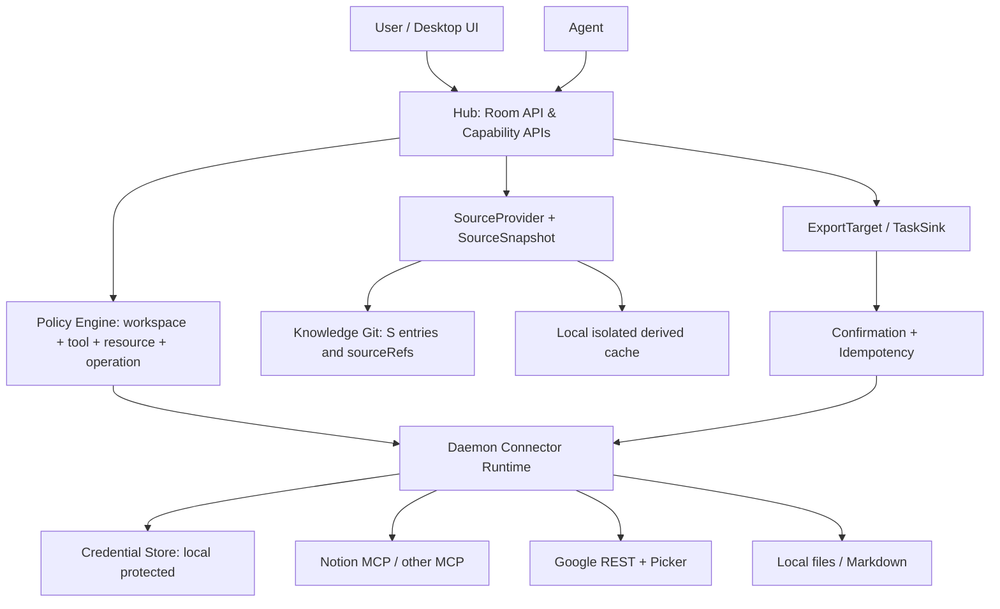

# Nema Room 外部连接器与可信来源架构设计

**版本**：v0.2.1 Draft for Review  
**日期**：2026-10-27  
**状态**：架构提案，尚未批准实施  
**目标仓库**：`Nema-Project/nema-room`  
**适用范围**：本地优先桌面版；Hub、Daemon、Knowledge、CLI、Web  
**基础材料**：《Nema Room 插件系统下一阶段：调研与设计》（2026-10-27）；仓库 `main` 中 `plugins.ts`、`roomApi.ts`、`entry.ts`、`extensions/store.ts`、`ROADMAP.md` 的只读检查。**未运行测试；实施前须按提交重新核实。**

## 0. 执行摘要

**结论：有条件接受原设计的方向，不直接执行原 CN-01～CN-08。** MCP 是连接协议，不是权限模型；连接器工具、产品业务能力和可信知识证据必须分层。优先完成稳定化 P0，随后建立来源证据协议、细粒度授权和版本快照，再接入远程 SaaS。

核心原则：

1. Agent 仅通过 Hub Room API 调用工具；Daemon 持有第三方凭据。Hub 之外的 Daemon 入口也必须验证调用上下文，防止绕过授权。
2. 账号 OAuth 授权、工作区资源绑定、工具级执行授权分别管理；远端 MCP 的 `readOnlyHint` 只作提示。
3. 外部文本属于不可信数据；不能凭文档正文提升权限、自动触发工具或将推断升级为用户决策。
4. 外部全文默认不提交知识 Git；只保存来源元数据、明确摘录和证据引用；缓存本地隔离、可重建、可清除。
5. 写入采用一次性、绑定参数的用户确认；失败重试必须幂等。
6. 插件基础设施不得延误发布稳定化和核心 Agent 语义验收。

## 1. 背景、现状与约束

### 1.1 现有实现（已通过源码静态检查）

- `packages/shared/src/plugins.ts`：`PLUGINS` 常量、`PluginManifest`、`readOnly`、`scope: repo | github | none`。
- `apps/hub/src/plugins.ts`：`workspace_plugins`、工具暴露、按插件 ID 的 settings 分支及 GitHub 写入特判。
- `apps/hub/src/roomApi.ts`：`POST /plugins/:name` 检查已启用工具；GitHub 目标由仓库绑定检查；`POST /entries` 要求至少一个本工作区 `sourceMessages`，且 `quotes` 与消息文本/版本精确对应。
- `apps/cli/src/extensions/store.ts`：已有扩展记录及托管目录的管理操作；并非仅 list，但不是通用远程 MCP 执行器。
- `ROADMAP.md`：发布前 P0 尚含发布门禁、真实 Agent 验收、升级恢复等工作；能力扩展应服从稳定化。

### 1.2 现有问题

静态清单无法灵活注册远程连接器；缺统一 OAuth 与资源绑定；知识 `source` 只有 URL 无稳定版本；外部文档不满足 `sourceMessages` 证据协议；工具层缺可复用的导入/导出/任务适配；通用 MCP 参数无法用简单 `resourceId` 检查可靠限制范围。

### 1.3 非目标

本阶段不做：第三方插件市场、任意未审计 MCP 自动安装、全量后台索引、多人共享 OAuth 凭据、云端凭据托管、双向实时同步、任意外部写入自动执行。暂不改变现有知识条目 `basis` 的语义。

## 2. 目标架构



**层次边界：**

| 层 | 职责 | 禁止 |
|---|---|---|
| Connector Runtime（Daemon） | OAuth、MCP 传输、重连、超时、schema 快照、外部 API 调用 | 接受无可信工作区上下文的特权调用 |
| Policy Engine（Hub + Daemon 校验） | 工作区、资源、操作、身份、用户确认、审计 | 把 MCP 工具描述当权限保证 |
| Capability Adapters | `SourceProvider`、`ExportTarget`、`TaskSink` | 依赖模型自由组合工具完成关键业务事务 |
| Knowledge | S 条目、`sourceRefs`、依赖、版本与过时状态 | 把外部推断伪装成用户决定 |
| UI | 账号连接、资源绑定、导入预览、写入 diff、撤销授权 | 静默扩大访问范围 |

## 3. 数据契约

以下 TypeScript 为**建议协议草案**，并非仓库现有类型；最终字段和迁移需另行评审。

```ts
type SourceSnapshot = {
  schemaVersion: 1;
  provider: string;
  resourceId: string;              // provider 内稳定 ID
  revision: string | null;         // null = 无法验证版本
  fetchedAt: string;               // ISO-8601
  title: string;
  canonicalUrl: string | null;
  contentHash: string;             // 规范化内容哈希，不代替远端 revision
  excerpts: Array<{
    locator: string;               // blockId / heading / line range
    text: string;                  // 长度受限
  }>;
};

type SourceRef = {
  sourceEntryId: string;           // S-n
  revision: string | null;
  locator?: string;
  quote?: string;
};

type SourceFreshness =
  | "current" | "changed" | "unavailable" | "unknown";

type WorkspaceSourceBinding = {
  workspaceId: string;
  connectorId: string;
  provider: string;
  resourceId: string;
  allowedOperations: Array<"read" | "export" | "update">;
  createdAt: string;
};
```

### 3.1 证据模型的兼容规则

当前 `POST /entries` 必须引用已有聊天消息。**不能直接让外部文档冒充聊天消息**。建议新增可选 `sourceRefs`，逐步支持：

- 聊天驱动条目：维持 `sourceMessages` 与原有 quote 精确验证。
- 外部导入 S 条目：由专用 `source__import` 路径创建，保存经过校验的 `SourceSnapshot` 元数据与摘录，不能走无证据的普通 Agent upsert。
- 外部资料推断的需求：`basis: inferred`，引用 S 条目及其 revision；若同时引用聊天则两套证据并存。
- 决策提升至 `stated/decided`：仍需明确用户消息或独立、可审计的用户确认事件；外部文档不能直接证明“用户决定”。
- 既有已定决策的修改限制保持不变；引入 sourceRefs 不得绕过。
- 兼容旧数据：`sourceRefs` 可选；旧 S 条目缺 revision 时为 `unknown`，不得自动标为 `current`。

**待决问题**：用户确认事件是否落在 `messages` 中，还是新增独立 evidence event 表；需与当前 `roomApi.ts` 的防改写逻辑共同设计。

### 3.2 存储权威来源

| 数据 | 权威存储 | 可重建 |
|---|---|---|
| 用户确认的 S 元数据、摘录、证据引用 | 知识 Git | 否 |
| 工作区资源绑定、授权开关、审计 | 本地 DB | 否 |
| OAuth token / refresh token | Daemon 本机私密凭据存储 | 否 |
| 外部全文缓存、索引、临时搜索结果 | 本地派生缓存 | 是 |
| 远端最新 revision | 第三方服务 | 由检查刷新 |

缓存需有工作区隔离、容量/TTL 限制、权限撤销后清理、备份默认排除和敏感数据脱敏规则。凭据存储必须使用现有私密文件 helper 并验证 Windows ACL/macOS 权限；有条件时使用系统密钥存储。

## 4. 授权与威胁模型

### 4.1 三层授权

1. **Account Connection**：用户为连接器完成 OAuth；表示第三方服务授予的最大权限。
2. **Workspace Binding**：用户将特定文件、页面或容器绑定到工作区；范围小于或等于账号授权。
3. **Operation Grant**：具体工具和操作是否允许；写操作须附一次性用户确认。

执行时取三者交集，默认拒绝。Daemon 应接收 Hub 签发、短时有效、绑定任务和工作区的执行上下文，并对连接器调用重新验证关键授权条件；不得信任 Agent 自报的 workspace ID。

### 4.2 MCP 工具分类

| 类别 | 处理 |
|---|---|
| `workspace-safe` | 适配器可证明只能访问绑定资源，允许在启用后读取 |
| `requires-binding` | 能可靠抽取并验证目标资源 ID，逐次校验 |
| `interactive-discovery` | 搜索、浏览目录等仅在用户交互流程中运行；结果不自动扩展绑定 |
| `unsupported` | 目标范围无法证明或具有不受控副作用，禁止自动暴露给 Agent |

**重要**：通用 MCP schema 不保证所有访问目标都在显式 `resourceId` 字段里。不能仅做 JSON 字段白名单或正则 URL 检查。支持的工具必须由适配器声明资源解析与授权策略；未知工具默认 `unsupported`。

### 4.3 主要威胁及防护

| 威胁 | 防护 |
|---|---|
| Prompt injection（文档要求 Agent 调用工具） | 外部内容数据化；不继承指令优先级；写入必须独立授权 |
| Confused deputy（高权限 token 跨工作区读取） | 工作区绑定 + 适配器策略 + Daemon 二次检查 |
| Schema drift / 工具被替换 | 保存 tool ID、schema hash、服务器标识；变化后停用待确认 |
| SSRF / 恶意 MCP endpoint | 仅允许可信连接器或显式审核的 endpoint；阻止回环/私网重定向等危险目标 |
| OAuth callback 劫持 | PKCE、state、loopback 限定、超时与一次性回调 |
| Token 泄露 | 私密文件权限、日志脱敏、Hub 不持有 token |
| 重试重复写入 | 幂等键、操作日志、目标回读核对 |
| 资源被删除/撤权 | `unavailable` 状态、停止刷新、按策略清缓存 |
| TOCTOU（确认后参数变化） | 确认时对目标/参数/身份/过期时间计算摘要，执行前复核 |

### 4.4 写入确认协议

```ts
type PendingWrite = {
  operationId: string;
  workspaceId: string;
  connectorId: string;
  accountId: string;
  targetResourceId: string;
  operation: string;
  payloadHash: string;
  preview: string;       // 人类可读 diff/摘要
  expiresAt: string;
  idempotencyKey: string;
  status: "pending" | "approved" | "executed" | "rejected" | "expired";
};
```

状态转换：`pending -> approved -> executed`；拒绝/过期终态。批准只允许一次，目标、参数或身份变化必须重建申请。若外部 API 不支持幂等键，需本地操作台账和重试前查询，明确不能保证跨崩溃的严格 exactly-once。

## 5. 来源版本与失效传播

**不要**简单以 `modifiedTime > lastConfirmedAt` 断言决策失效。

分别存储 `importedRevision`、`lastCheckedRevision`、`lastConfirmedRevision`；有的服务只提供时间戳，则注明精度与可靠性。版本比较优先使用服务提供的强版本标识，否则使用内容哈希；无法比较时返回 `unknown`。

- `current`：远端可验证版本与导入版本一致。
- `changed`：远端版本与导入版本不同。
- `unavailable`：已删除、无权限或不可访问；区分错误原因，不将网络暂时故障当删除。
- `unknown`：离线、超时、无版本能力或检查未完成。

依赖图：`S-n -> R/D/T/Q/W`。来源变化只将依赖项标记 `review-needed`，**不得自动撤销或改写已定决策**。检查触发为打开来源、启动关联任务、用户手动刷新；不做默认后台全量轮询。使用退避、ETag/If-None-Match（若服务支持）与频率上限。

## 6. 连接器与业务能力接口

```ts
interface SourceProvider {
  resolve(input: string): Promise<{ resourceId: string; title?: string }>;
  fetchSnapshot(resourceId: string): Promise<SourceSnapshot>;
  checkRevision(resourceId: string, knownRevision: string | null):
    Promise<{ freshness: SourceFreshness; revision: string | null }>;
}
interface ExportTarget {
  previewExport(input: unknown): Promise<{ targetId: string; diff: string; payloadHash: string }>;
  executeApprovedExport(operationId: string): Promise<{ url: string; externalId: string }>;
}
interface TaskSink {
  previewTask(input: unknown): Promise<{ targetId: string; diff: string; payloadHash: string }>;
  executeApprovedTask(operationId: string): Promise<{ externalId: string; url: string }>;
}
```

接口在产品层实现；普通 MCP 工具不自动成为 `SourceProvider`。通用工具由 `connectorId__toolName` 命名，限制输出大小、执行时间、并发与调用预算。远程服务器断线需有明确错误状态、重试策略和审计。

## 7. 连接器优先级

| 顺序 | 连接器/能力 | 目标 | 前置条件 |
|---|---|---|---|
| 1 | 注册表 + 策略骨架 | 清理静态插件与硬编码写入门禁 | 不改变旧插件行为 |
| 2 | 外部证据协议 | S 条目和 sourceRefs 可追溯 | 迁移与恢复设计 |
| 3 | GitHub Issue/PR 增强 | 开发包 ↔ Issue/PR/交付证据 | 复用现有 GitHub 授权 |
| 4 | 本地 Markdown/文件夹 | 无 OAuth 验证来源链路 | 路径沙箱、文件权限 |
| 5 | 远程 MCP + OAuth | 通用运行能力 | 威胁模型与授权测试 |
| 6 | Notion 只读 | 首个远程 MCP 来源试点 | 认证与工具 schema 实测 |
| 7 | Google Drive/Docs | Picker 选定文件的只读导入 | `drive.file` 能力与审核验证 |
| 8 | ExportTarget/TaskSink | 受控外部写入 | 操作确认、幂等、回滚策略 |

**取舍**：Notion 适合测试远程 MCP；本地 Markdown 更适合测试知识与证据闭环。两种试点目的不同，不互相替代。Google Picker、OAuth 客户端类型、`drive.file` 与导出格式应按实施时官方文档和真实账号验证；原文相关表述不能视作已测试事实。

## 8. 实施计划与验收

插件任务使用 `CX-` 编号，避免与仓库发布稳定化 P0/P1/P2 混淆。

| ID | 任务 | 交付物 | 验收门槛 |
|---|---|---|---|
| CX-00 | 发布稳定化前置 | P0 验收记录 | 不以插件工作替代真实 Agent/升级/发布验证 |
| CX-01 | 插件注册表 | 统一 manifest + settings schema | 原有 5 插件功能、默认开关、GitHub 范围回归通过 |
| CX-02 | 权限策略 | tool classification + policy engine | 跨工作区、嵌套资源、搜索绕过测试全部拒绝 |
| CX-03 | 来源证据模型 | SourceSnapshot + sourceRefs + migration | 旧数据可读、旧决策防改写不退化 |
| CX-04 | 本地来源试点 | Markdown SourceProvider | 变更、删除、撤权、离线及注入测试 |
| CX-05 | GitHub 关联 | Issue/PR links + evidence | 不误判 PR 合并为需求验收 |
| CX-06 | OAuth/MCP Runtime | PKCE + transport + schema pinning | Token 不出 Daemon；断线/撤销/重连测试 |
| CX-07 | Notion read-only | 页面导入 + 版本检查 | 真实账号与权限边界端到端验证 |
| CX-08 | Google read-only | Picker + Docs/Sheets/Slides 按能力导入 | 实测授权、导出、文件权限和错误路径 |
| CX-09 | 写入确认 | PendingWrite + idempotency | 未批准绝不写；重复请求不重复创建 |
| CX-10 | UI + 运维 | 状态、绑定、预览、清理、审计 | 中英日文案；无 token 泄露；升级恢复验证 |

### 8.1 测试矩阵

- **单元**：manifest/schema、scope policy、revision 比较、hash、状态机、旧 schema 迁移。
- **集成**：Hub→Daemon 可信上下文、工作区绑定、MCP schema drift、超时、401/403、撤销 token。
- **安全**：跨工作区读取、嵌套参数、任意搜索、提示注入、重定向、日志脱敏、确认重放。
- **E2E**：导入来源→生成 inferred 需求→用户确认→开发包→Issue/PR→证据关联。
- **桌面**：Windows/macOS 安装、升级、备份恢复、Daemon 离线、浏览器 OAuth 回调。
- **非功能**：大文档截断与分页、限流、缓存配额、响应超时、失败可诊断性。

每项验收附提交 SHA、测试命令、结果、环境、日期和人工确认记录；CI 通过不等于真实模型语义验收。

## 9. 数据迁移与回滚

1. 先扩展 schema：旧条目仍有效，新增字段可选。
2. 引入读取兼容层，不立即批量改写历史 Git。
3. 专用 `source__import` 采用可重试的事务边界；Git 提交成功但 DB 索引失败时通过现有对账机制恢复。
4. 开启新连接器前备份知识 Git 与本地 DB；**不把 token 打包到备份**。
5. Feature flag 按连接器/工作区逐步启用；出现问题可关闭新工具而不破坏既有知识。
6. 回滚仅关闭运行能力和恢复索引，不删除用户已确认的 S 条目；新旧版本兼容范围需测试明确。

## 10. 待批准的架构决策（ADR）

| ADR | 提议 | 状态 |
|---|---|---|
| ADR-01 | 全文不进知识 Git，存元数据、摘录和引用 | 待批准 |
| ADR-02 | `basis` 不变，增加 `sourceRefs` 与用户确认事件 | 待批准 |
| ADR-03 | 账号/工作区/操作三级授权 | 待批准 |
| ADR-04 | 未审计 MCP 工具默认禁止 Agent 调用 | 待批准 |
| ADR-05 | 外部写入每次按不可变参数确认 | 待批准 |
| ADR-06 | 本地 Markdown 验证来源闭环，Notion 验证远程 MCP | 待批准 |
| ADR-07 | 插件实施不阻塞当前发布稳定化 P0 | 待批准 |
| ADR-08 | 来源变化标记依赖待复核，不自动废止决策 | 待批准 |
| ADR-09 | Google OAuth 公共客户端 + 可选 BYO（须核实审核要求） | 待批准 |

### ADR-09：Google OAuth 客户端归属（待批准）

**问题**：桌面客户端由项目维护统一 OAuth Client，还是要求用户自行创建 GCP 项目？这决定 CX-08 的接入门槛、同意屏幕、审核与隐私披露责任。

| 方案 | 优势 | 代价 / 风险 |
|---|---|---|
| A. 项目公共 OAuth 客户端 | 普通用户可直接连接；统一文档与支持 | 项目维护配置、同意屏幕、可能的 Google 验证和隐私披露；桌面应用客户端标识不是秘密 |
| B. BYO GCP OAuth 客户端 | 高级用户控制项目与配额；适合内部试验 | 配置门槛高，容易出错；并不天然消除 OAuth 合规要求 |
| C. 公共客户端 + 可选 BYO | 默认体验友好，同时保留高级部署灵活性 | 需要维护两套配置、回调与故障排查路径 |

**建议（尚未批准）**：目标选 C；CX-08 初期允许 BYO 进行技术验证，公共客户端上线前完成 Google 对所需 scopes、应用类型、验证与隐私披露的官方核实。不得将桌面应用的 client secret 当作机密。所有方案均继续遵守 ADR-03 的工作区权限边界。

## 11. 需进一步核实的事实

- Notion MCP 当前授权方式、可用工具及页面权限语义。
- Google OAuth 公共客户端、Picker `drive.file` 组合、Docs/Sheets/Slides 实际导出格式与审核限制。
- MCP TypeScript SDK 当前版本、OAuth client metadata 支持、DCR/CIMD 和 loopback 回调兼容性。
- 当前仓库是否已有可复用的持久化幂等操作、来源引用和事件审计结构。
- 当前 HEAD 的发布 P0 进展及可能影响本文的近期 PR。
- Windows/macOS 的本地密钥安全、文件 ACL、协议回调与安装包行为。

上述内容不作为已验证的实施前提。

## 12. 给执行 Agent 的下一步

**只做设计准备，不直接改动生产数据或创建远程写操作。**

1. 重新读取仓库 HEAD、当前 ROADMAP 和关联 PR；记录 commit SHA。
2. 为 `sourceRefs`、`SourceSnapshot`、`workspace_sources`、`PendingWrite` 生成最小 schema/迁移提案。
3. 绘制当前 `POST /entries` 证据校验与拟议外部证据校验的对照流程，列出所有可能绕过已定决策保护的路径。
4. 列出 MCP 工具分类与策略接口，并提供跨工作区、隐式资源、搜索、嵌套参数的拒绝测试用例。
5. 对 `ExtensionStore`、`PLUGINS`、`workspace_plugins` 给出兼容改造方案，禁止平行重复注册表。
6. 将提案分成可独立审查的 PR，先完成 schema 与测试，再考虑 OAuth/Notion/Google 接入。
7. 输出 ADR 待决项，等待用户批准后再实施有迁移风险的步骤。

---

## 参考

- 原始调研：《Nema Room 插件系统下一阶段：调研与设计》（2026-10-27；原件未存入仓库，不能作为独立可访问的审查依据）。关键依赖结论见下方附录 A。
- [GitHub 仓库](https://github.com/Nema-Project/nema-room)
- [插件清单](https://github.com/Nema-Project/nema-room/blob/main/packages/shared/src/plugins.ts)
- [Hub 插件管理](https://github.com/Nema-Project/nema-room/blob/main/apps/hub/src/plugins.ts)
- [Room API](https://github.com/Nema-Project/nema-room/blob/main/apps/hub/src/roomApi.ts)
- [知识条目 Schema](https://github.com/Nema-Project/nema-room/blob/main/packages/shared/src/entry.ts)
- [扩展存储](https://github.com/Nema-Project/nema-room/blob/main/apps/cli/src/extensions/store.ts)
- [ROADMAP](https://github.com/Nema-Project/nema-room/blob/main/ROADMAP.md)

**来源界限**：现状来自用户提供文档与本次 GitHub 静态检查；本文件新增的类型、权限策略、快照模型、实施顺序和验收标准均为设计建议，尚非已实现功能。

## 附录 A：原始调研中与本提案相关的关键结论（便于独立评审）

原始调研提出：当前插件基于静态清单、工作区开关及 GitHub 特判；拟以 Daemon 管理 OAuth 与 MCP 连接、Hub 进行授权，优先支持 Notion 与 Google 来源，并规划 `SourceProvider / ExportTarget / TaskSink` 及 `source__import`。它提出外部全文默认不入知识 Git、外部推断保持 `inferred`、外部写入逐次确认，以及以远端修改时间检查过时性。本文保留其分层方向，但针对资源级授权、`sourceMessages` 证据冲突、版本失效传播和幂等写入补充设计。此附录为与本文相关的**摘要**，不是原调研全文或逐字引述；实施时须对照原件和当前仓库源码复核。
